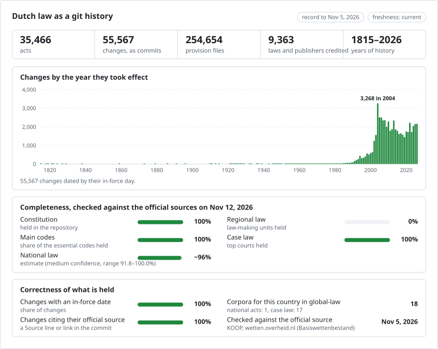

# Netherlands: law history in git

**English** · **[Of lees het in het Nederlands](README.md)**

<picture>
<source media="(prefers-color-scheme: dark)" srcset="data/effort-dark.svg">

</picture>

The law of the Netherlands as a git history: one file per article, one commit per version on the day it took effect, and the act that made each change, named by its Staatsblad or Staatscourant publication, as the commit's author. `git blame` names the act behind every article; `git log` lists every change to an article; picking a date gives the text in force that day.

Part of [lexifina/global-law](https://github.com/lexifina/global-law), one git history for every country's law: this is the Netherlands' national law, which global-law reads at `netherlands/national/acts/`.

**What is in it now:** the Constitution, the Charter for the Kingdom and 42,434 regulations of the Basiswettenbestand (3,507 laws, 4,851 orders in council and royal decrees, 21,392 ministerial regulations, 6,520 regulations of independent bodies and former product boards, 2,815 policy rules, circulars and reglementen, and 3,349 treaties), with 72,144 versions; and 853 local regulations of the provinces of Drenthe and Flevoland, with 1,343 versions. [`PLAN.md`](PLAN.md) lists every part this repository is meant to hold and how far each one is; [`local/README.md`](local/README.md) lists the local regulations by authority.

Each act is in `<kind>/<year>/<number>/`, from its first publication in the Staatsblad (laws and royal decrees) or the Staatscourant (the rest): `wet/1991/600-BWBR0005290/` is Burgerlijk Wetboek Boek 7, whose Title 10 is the employment contract, with the BWB id added because Stb. 1991, 600 also holds Books 3, 5 and 6; the Constitution is [`grondwet/1815/`](grondwet/1815/). Treaties are in `verdrag/<year concluded>/<treaty number>/` and local regulations in `local/<authority>/<year>/<CVDR id>/`. Until 13 November 2026 the acts were folders named by their id (`bw-boek-7/`); [`data/paths.json`](data/paths.json) maps each id to its folder.

The text is in Dutch, as the BWB and the CVDR publish it; treaties are also in the other languages the BWB gives them in. An English translation is not part of this record.

## Questions as git commands

| Question | Command |
| --- | --- |
| Every change to Article 7:670 of the Civil Code (bans on dismissal) | `git log -p --follow --word-diff -- wet/1991/600-BWBR0005290/art-670.md` |
| Which act wrote each line of Article 7:670? | `git blame wet/1991/600-BWBR0005290/art-670.md` |
| Every version of Book 7, with the day each took effect | `git log --format="%h %(trailers:key=In-force,valueonly,separator=) %an" -- wet/1991/600-BWBR0005290 bw-boek-7` |
| Article 7:670 as in force on 1 January 2015 | `python tools/geldend_op.py 2015-01-01 bw7 670` |

**Outside git**, we also host this record publicly, for free:

- **[Ask Claude about Dutch law](https://global-law.lexifina.com/v1/try_claude?country=netherlands)**: opens Claude with a first question ready.
- **[Ask ChatGPT](https://global-law.lexifina.com/v1/try_chatgpt?country=netherlands)**: the same question in ChatGPT.
- **[Call the API in your browser](https://global-law.lexifina.com/v1/search_law?query=vakantiedagen&jurisdictions=netherlands)**: a search of Dutch law for "vakantiedagen", returned as JSON. See the [documentation here](https://lexifina.com/api/global-law).

Both assistants read the record through the free Global law connector (MCP, `https://global-law.lexifina.com/mcp`); the first time, the chat gives you the link that adds it. Ask in Dutch or in English.

**Host it yourself easily.** All it takes is git and Python, and the tools run on your machine:

```sh
git clone --depth 1 https://github.com/lexifina/global-law && cd global-law
python3 tools/countries.py add netherlands/national/acts
python3 tools/law.py show 2026-01-01 netherlands/national/acts/wet/1991/600-BWBR0005290/art-670.md
```

Opened in Claude Code, Cursor, VS Code or Codex, the clone also starts a local MCP server with the same tools ([MCP.md](https://github.com/lexifina/global-law/blob/main/MCP.md)).

## Dates

Each commit is dated at noon, Europe/Amsterdam, on the day the version took effect, and carries it in its `In-force:` trailer:

- for a national act, the BWB's in-force date for each consolidated version (`datum_inwerkingtreding`), which already applies the act's own commencement rules;
- for a local regulation, the day the CVDR gives each version;
- git cannot store dates before 1970, so the 1,100 earlier versions are dated from 1970-01-01, one second apart, with the real day in `In-force:`. Ask for a date with `tools/geldend_op.py`, not `git log --before`.

Each change is credited to the publication the BWB or the CVDR names for it (`Stb. 2014, 504`, `prb-2026-18788 (Drenthe)`); where it names none, to KOOP, the publisher. The first version of each act is the oldest one the BWB keeps (for the codes, from 2002), credited to KOOP.

## How it is checked

- National versions are read back from git on the day each took effect and on the day before, and must match the corpus (`tools/check_repo.py`); [`REPRODUCE.md`](REPRODUCE.md) records the results.
- Every local regulation is checked word for word against the CVDR's XML; one that fails is held back and retried.
- Every commit's trailers parse; there are no merge commits and no commit dated after the build.
- History is append-only: `main` only grows, and no published commit is rewritten.

## What it does not show

- **Most local law.** 853 of the CVDR's 285,881 local regulations are here; the other 10 provinces, all 342 municipalities, the 21 water boards, joint arrangements and the Caribbean public bodies are not yet.
- **Earlier versions of many acts.** 72,144 of the BWB's 148,873 consolidated versions are here; 7,934 acts are held with their current text only, and history before the BWB's oldest version is not reconstructed.
- **Some national regulations.** 4,624 of the BWB's 47,060 regulations are not here, most of them repealed or expired.
- **EU law, bills and parliamentary papers, the Raad van State's opinions, and the gazettes' own texts** are planned parts (see `PLAN.md`).
- **Case law** is kept in 15 separate repositories, with 932,076 decisions (listed in `PLAN.md`).

## Sources

| Source | Kind | Past versions | Notes |
| --- | --- | --- | --- |
| [Basiswettenbestand](https://wetten.overheid.nl) (KOOP) | Official consolidated national legislation and treaties | yes, every consolidated version the BWB keeps | The text of every version, its in-force day and the publication behind each change |
| [Officiële bekendmakingen](https://zoek.officielebekendmakingen.nl) | Staatsblad, Staatscourant, provincial gazettes | as published | Each change's publication and its dates |
| [CVDR](https://lokaleregelgeving.overheid.nl) (KOOP) | Local regulations | yes, every consolidated version the CVDR keeps | Every Dutch authority's regulations; Drenthe and Flevoland so far |

## Licence

See [`LICENSE`](LICENSE). KOOP publishes the BWB and officielebekendmakingen.nl as open data under CC0 1.0, Dutch statutes, decrees and regulations are not protected by copyright (Auteurswet, art. 11), and each CVDR record states that it is free of copyright and database right. The history, commit messages, tables and tools are CC0 1.0.

No AI model wrote or changed legal text; the scripts were written by an AI model (see [`REPRODUCE.md`](REPRODUCE.md)).

## More

From [lexifina/global-law](https://github.com/lexifina/global-law):

- [FEATURES.md](https://github.com/lexifina/global-law/blob/main/FEATURES.md): every feature, and what every corpus must support (`git blame`, `law.py`, the MCP tools)
- [FAQ.md](https://github.com/lexifina/global-law/blob/main/FAQ.md): questions and answers · [CONTRIBUTING.md](https://github.com/lexifina/global-law/blob/main/CONTRIBUTING.md): proposing changes · [MCP.md](https://github.com/lexifina/global-law/blob/main/MCP.md): the MCP server · [REPRODUCE.md](https://github.com/lexifina/global-law/blob/main/REPRODUCE.md): how it was built · [CHANGELOG.md](https://github.com/lexifina/global-law/blob/main/CHANGELOG.md)
- [FRESHNESS.md](https://github.com/lexifina/global-law/blob/main/FRESHNESS.md): how current each corpus is · [Monitoring](https://github.com/lexifina/global-law/tree/main/monitoring): whether updates are running · [WATCHING.md](https://github.com/lexifina/global-law/blob/main/WATCHING.md): how each official source is watched for changes
- [performance/](https://github.com/lexifina/global-law/tree/main/performance): how fast the tools are, measured
- [visualisations/](https://github.com/lexifina/global-law/tree/main/visualisations): charts and bridges across the world's law
- [Vulnerabilities](https://github.com/lexifina/global-law/tree/main/vulnerabilities): mistakes in legislation as published
