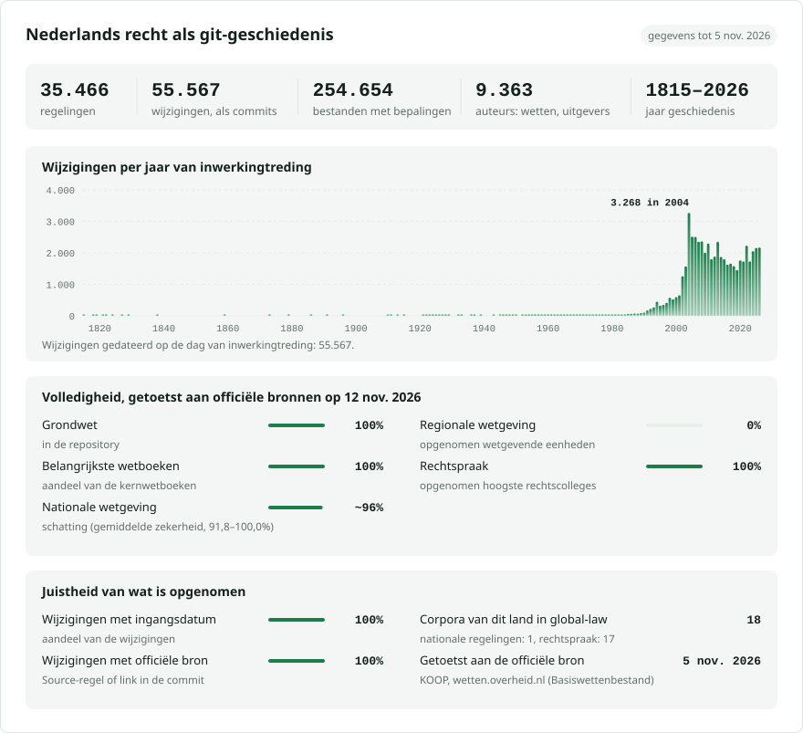

# Nederland: wetgevingsgeschiedenis in git

**Nederlands** · [English](README.en.md)

<picture>
<source media="(prefers-color-scheme: dark)" srcset="data/nl/effort-dark.svg">

</picture>

Onderdeel van [lexifina/global-law](https://github.com/lexifina/global-law), één git-geschiedenis van het recht van alle landen: dit is het nationale recht van Nederland, dat global-law inleest onder `netherlands/national/acts/`.


## Hoe de repository is ingedeeld

Elke regeling is een map `<kind>/<year>/<number>/`, genoemd naar haar officiële kenmerken, zoals in [romania-law](https://github.com/lexifina/romania-law) en [japan-law](https://github.com/lexifina/japan-law): de soort die het Basiswettenbestand aan de regeling geeft, en het jaar en nummer van de oorspronkelijke publicatie (het Staatsblad voor wetten en koninklijke besluiten, de Staatscourant voor de rest; met `stb-`/`stcrt-`/`trb-` ervoor als de regeling in het andere publicatieblad verscheen). Verdragen staan in `verdrag/<year concluded>/<Treaty database number>/`. Waar twee regelingen hetzelfde publicatienummer hebben (vóór 2009 is een Staatscourantnummer een volledige uitgave), wordt het BWB-id toegevoegd (`ministeriele-regeling/1995/244-BWBR0007685`); waar geen publicatie bekend is, is de map het BWB-id. Binnen een map is elk artikel een eigen bestand en somt `README.md` de artikelen op.

| Map | Inhoud | Regelingen |
| --- | --- | ---: |
| `ministeriele-regeling/` | ministeriële regelingen (jaar en nummer van de Staatscourant) | 19.708 |
| `zbo/` | regelingen van zelfstandige bestuursorganen (zbo) | 3.970 |
| `amvb/` | algemene maatregelen van bestuur (AMvB) | 3.656 |
| `verdrag/` | verdragen (jaar van sluiting, nummer in de Verdragenbank) | 3.349 |
| `wet/` | wetten (jaar en nummer van het Staatsblad; wet/1992/315 is de Awb) | 3.204 |
| `pbo/` | regelingen van voormalige productschappen (PBO) | 2.550 |
| `beleidsregel/` | beleidsregels | 2.321 |
| `archiefselectielijst/` | archiefselectielijsten (ministeriële regelingen) | 1.315 |
| `kb/` | koninklijke besluiten (KB) | 877 |
| `circulaire/` | circulaires | 422 |
| `ministeriele-regeling-bes/` | ministeriële regelingen voor de BES-eilanden | 369 |
| `amvb-bes/` | algemene maatregelen van bestuur voor de BES-eilanden | 230 |
| `wet-bes/` | wetten voor Bonaire, Sint Eustatius en Saba | 185 |
| `rijkswet/` | rijkswetten | 118 |
| `rijkskb/` | koninklijke besluiten van het Koninkrijk | 85 |
| `reglement/` | reglementen | 50 |
| `beleidsregel-bes/` | beleidsregels voor de BES-eilanden | 20 |
| `rijksamvb/` | algemene maatregelen van rijksbestuur | 3 |
| `circulaire-bes/` | circulaires voor de BES-eilanden | 2 |
| `grondwet/` | de Grondwet (grondwet/1815) | 1 |
| `statuut/` | het Statuut voor het Koninkrijk (statuut/1954) | 1 |
| `local/<authority>/<year>/<CVDR id>/` | lokale regelgeving (CVDR): tot nu toe de provincies Drenthe en Flevoland; gemeenten, waterschappen en de overige provincies zijn er nog niet | 467 |
| `data/` | tabellen: `paths.json` (van elk regeling-id naar de map), `versions.json`, `laws.csv`, `commits.csv` | |
| `tools/` | het bouwprogramma en de leesprogramma's | |

Tot 13 november 2026 waren de regelingen mappen op het hoogste niveau, genoemd naar hun id (`awb/`, `grondwet/`). [`data/paths.json`](data/paths.json) geeft voor elke oude naam de nieuwe map, en `git log --follow` volgt een bestand over de verplaatsing heen:

```
python -c "import json; print(json.load(open('data/paths.json'))['paths']['awb'])"   # wet/1992/315
git log --follow --oneline -- wet/1992/315/art-01-001.md
```

## Wat er nog niet is

Geteld aan de hand van de officiële overzichten op 13 november 2026; [PLAN.md](PLAN.md) bevat elk onderdeel met de voortgang ervan. Volgens die telling is **58,8%** van het plan gepubliceerd.

- **Lokale regelgeving, vrijwel geheel.** 467 van de 285.881 lokale regelingen in het CVDR staan hier: die van de provincies Drenthe en Flevoland. Nog niet hier: de andere 10 provincies, alle 342 gemeenten (256.270 regelingen), de 21 waterschappen, gemeenschappelijke regelingen en de Caribische openbare lichamen.
- **Eerdere versies van veel nationale regelingen.** 72.144 van de 148.873 geconsolideerde versies in het BWB staan hier (48%). Van 12.346 regelingen ontbreken eerdere versies die het BWB wel publiceert, en 7.934 daarvan zijn alleen met hun huidige tekst opgenomen, zodat `git log` en `git blame` voor die regelingen bij die tekst beginnen en niet bij de regeling zoals die oorspronkelijk is gepubliceerd.
- **Enkele nationale regelingen.** 1.784 ministeriële regelingen, 833 regelingen van zelfstandige bestuursorganen en productschappen, 1.616 beleidsregels, circulaires en reglementen, 357 verdragen, 26 algemene maatregelen van bestuur en 8 wetten; de meeste daarvan zijn ingetrokken of vervallen. Van de 24.729 vervallen regelingen in het BWB ontbreken er hier 3.701.
- **Nog niet begonnen:** EU-recht in het Nederlands en de koppelingen met de omzetting; wetsvoorstellen, parlementaire stukken (Kamerstukken) en ontwerpen in consultatie; de adviezen van de Raad van State; publicaties van de Nationale ombudsman, de Algemene Rekenkamer en de Kiesraad; de teksten van het Staatsblad, de Staatscourant en het Tractatenblad zelf (elke wijziging vermeldt haar publicatie).
- **Rechtspraak staat apart:** ongeveer 932.000 uitspraken in 15 afzonderlijke repositories (opgesomd in PLAN.md), 95,6% van wat data.rechtspraak.nl publiceert.

## Wat deze repository bevat, en het plan

[PLAN.md](PLAN.md) somt elk onderdeel van het Nederlandse recht op dat deze repository moet gaan bevatten, met wat er tot nu toe is gepubliceerd ten opzichte van de officiële aantallen: nationale wetgeving uit het Basiswettenbestand (elke wet, algemene maatregel van bestuur, ministeriële regeling, regeling van een zelfstandig bestuursorgaan, beleidsregel en elk verdrag, geldend en ingetrokken), lokale regelgeving van elke gemeente, provincie, elk waterschap, elke gemeenschappelijke regeling en elk Caribisch openbaar lichaam uit de Centrale Voorziening Decentrale Regelgeving (in [local/](local/), één map per overheid), rechtspraak (in afzonderlijke repositories, opgesomd in PLAN.md), en daarna verdragen, EU-recht en wetsvoorstellen. Het overzicht wordt bij elke documentatiecommit opnieuw gegenereerd.

Teksten zijn overgenomen uit de officiële XML zoals gepubliceerd (wetten.overheid.nl / lokaleregelgeving.overheid.nl, KOOP; vrij van auteursrecht op grond van art. 11 Auteurswet en vrijgegeven als open data) en woord voor woord daartegen gecontroleerd. Elke commit is gedateerd op de dag waarop de tekst in werking trad en toegeschreven aan de publicatie die de wijziging aanbracht.

Dit is een vertaling van de Engelse versie ([README.en.md](README.en.md)); bij verschillen geldt de Engelse versie.

## Meer

Uit de repository [lexifina/global-law](https://github.com/lexifina/global-law) (in het Engels):

- [FEATURES.md](https://github.com/lexifina/global-law/blob/main/FEATURES.md): alle functies en wat elk corpus moet ondersteunen (`git blame`, `law.py`, MCP-tools)
- [FAQ.md](https://github.com/lexifina/global-law/blob/main/FAQ.md): vragen en antwoorden · [CONTRIBUTING.md](https://github.com/lexifina/global-law/blob/main/CONTRIBUTING.md): wijzigingen voorstellen · [MCP.md](https://github.com/lexifina/global-law/blob/main/MCP.md): MCP-server · [REPRODUCE.md](https://github.com/lexifina/global-law/blob/main/REPRODUCE.md): hoe het is gemaakt · [CHANGELOG.md](https://github.com/lexifina/global-law/blob/main/CHANGELOG.md)
- [FRESHNESS.md](https://github.com/lexifina/global-law/blob/main/FRESHNESS.md): hoe actueel elk corpus is · [Monitoring](https://github.com/lexifina/global-law/tree/main/monitoring): of de updates werken · [WATCHING.md](https://github.com/lexifina/global-law/blob/main/WATCHING.md): hoe elke officiële bron op wijzigingen wordt gevolgd
- [performance/](https://github.com/lexifina/global-law/tree/main/performance): hoe snel de tools zijn, gemeten
- [visualisations/](https://github.com/lexifina/global-law/tree/main/visualisations): grafieken en verbanden in het recht van de hele wereld
- [Kwetsbaarheden](https://github.com/lexifina/global-law/tree/main/vulnerabilities): fouten in regelingen zoals ze zijn gepubliceerd
