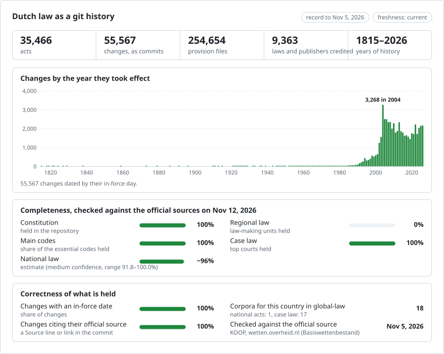

<picture>
<source media="(prefers-color-scheme: dark)" srcset="data/effort-dark.svg">

</picture>

Part of [lexifina/global-law](https://github.com/lexifina/global-law), one git history for every country's law: this is the Netherlands' national law, which global-law reads at `netherlands/national/acts/`.

## What this repository holds, and the plan

[PLAN.md](PLAN.md) lists every part of Dutch law this repository is meant to hold, with what is published so far against the official counts: national legislation from the Basiswettenbestand (every law, order in council, ministerial regulation, independent-body regulation, policy rule and treaty, in force and repealed), local legislation of every municipality, province, water board, joint arrangement and Caribbean public body from the Centrale Voorziening Decentrale Regelgeving (in [local/](local/), one folder per authority), case law (in separate repositories, listed in PLAN.md), and next treaties, EU law and bills. It is regenerated with each documentation commit.

Texts are copied from the official XML as published (wetten.overheid.nl / lokaleregelgeving.overheid.nl, KOOP; free of copyright under Auteurswet art. 11 and released as open data) and checked word for word against it. Each commit is dated the day the text took effect and credited to the publication that made the change.
