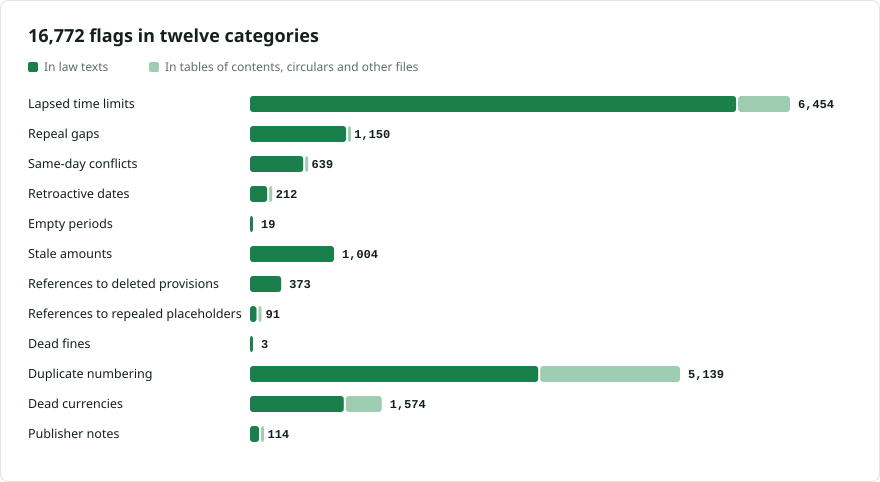

# Vulnerabilities in Dutch law

[Nederlands](README.md) · **English**

<picture>
<source media="(prefers-color-scheme: dark)" srcset="img/flags-by-category-dark.svg">

</picture>

The vulnerability detectors from [lexifina/global-law](https://github.com/lexifina/global-law/tree/main/vulnerabilities) look for mechanical mistakes in legislation: a rule applying "until" a date that has passed, a time limit extended only after it had run out, a provision repealed before its replacement took effect, an amount changed in one place but still standing in another, a reference to an article that no longer exists. global-law's published list (9 November 2026) covered the Netherlands with 16 flags, read from an earlier commit of this repository (`fdb8e5f`): 5 repeal gaps, 5 duplicate numbers, 3 entries into force before publication, 2 references to deleted provisions and 1 reference to a repealed placeholder, all in the Criminal Code, Book 1 of the Civil Code, the Constitution and the GDPR Implementation Act. This is a run over this repository only, the Constitution, the Charter for the Kingdom, 42,434 national regulations and treaties of the Basiswettenbestand and 853 local regulations of Drenthe and Flevoland, as it stood at commit [`d13d9e1`](https://github.com/lexifina/netherlands-law/commit/d13d9e1e39eb0153f8dda04ca291bf6ecae8558b) on 15 November 2026. It finds 16,772 flags: far more of the same five kinds (1,150 repeal gaps, 5,139 duplicate numbers, 212 entries into force before publication, 373 references to deleted provisions, 91 references to repealed placeholders), and seven categories that list did not have for the Netherlands: lapsed time limits (6,454), same-day conflicts (639), empty periods (19), stale amounts (1,004), dead fines (3), dead currencies (1,574) and publisher notes (114). One of the three entries into force before publication that global-law's review kept, the fine categories of art. 23 of the Criminal Code from 1 January 2022, is confirmed below.

**In short:** the detectors raised 16,772 flags. A language model reviewed 265 of the strongest, arguing each one for and against; 46 survived. Checked by hand in this repository, two of them are likely gaps or drafting mistakes. The power in art. 124(2) of the Spoorwegwet to designate railways as main railways ran until 1 January 2005, then 2008, then 2010, then 2013, and each extension took effect after the old date had passed, without retroactive effect, by 74, 486 and 936 days. And art. 15n of the Wet aanvullende bepalingen verwerking persoonsgegevens in de zorg, inserted in 2025, refers to "artikel 16, tweede lid", but the act has had no art. 16 since 2017. Among the flags the model did not review, art. 23 of the Criminal Code is a third: an order in council raised the maximum fines from 1 January 2022 and was published on 5 January 2022, although under art. 89(3) of the Constitution it cannot enter into force before publication. Of the other 44, 6 come from how this repository is built (a local regulation's files are numbered by position, so one file holds different articles over time), 6 are lawful, 4 are older regulations withdrawn by successors published months after the date they give, 2 cannot be decided without the provincial gazette, 2 are spent, 5 were misread by a detector and 19 are the same figure in a separate rule. Later, this will be formalised in Lean, similar to our work on [the US tax code](https://lexifina.com/blog/formalizing-the-us-tax-code) and [US case law](https://lexifina.com/blog/formalizing-all-us-case-law-in-lean).

A flag is a prompt to look, not legal advice, and nothing here has been tested in court.

## Flags by category

| Category | What it looks for | Flags | In law texts | Reviewed | Survived review |
| --- | --- | ---: | ---: | ---: | ---: |
| Lapsed time limits | Text still applying a rule "until" a date that has passed | 6,454 | 5,810 | 46 | 2 |
| Repeal gaps | A provision removed before its replacement took effect | 1,150 | 1,148 | 40 | 1 |
| Same-day conflicts | Two acts changing the same provision with the same in-force day | 639 | 636 | 40 | 2 |
| Retroactive or pre-publication dates | A change in force before the act that made it was published | 212 | 206 | 40 | 9 |
| Empty periods | A time limit extended by an act that took effect after it had run out | 19 | 19 | 19 | 10 |
| Stale amounts | An amount changed in one place but still standing elsewhere | 1,004 | 1,004 | 40 | 19 |
| References to deleted provisions | A provision citing an article that no longer exists | 373 | 373 | 40 | 3 |
| References to repealed placeholders | A provision citing an article that now reads only "[Vervallen]" | 91 | 78 | 0 | 0 |
| Dead fines | A penalty provision citing an article that reads "[Vervallen]" | 3 | 3 | 0 | 0 |
| Duplicate numbering | Two units with the same number in one provision | 5,139 | 3,444 | 0 | 0 |
| Dead currencies | Amounts in currencies no longer in use (the guilder and others) | 1,574 | 1,121 | 0 | 0 |
| Publisher notes | Notes that an amendment could not be carried out, or a "(sic)" | 114 | 107 | 0 | 0 |

"In law texts" counts the Constitution, the Charter, the laws, orders in council and royal decrees, ministerial regulations, regulations of independent administrative bodies and former product boards, policy rules, reglementen, archival selection lists, treaties and the local regulations. Policy rules (`beleidsregel/`) count as law: they are general rules adopted by decision (Awb, art. 1:3(4)), and the body that made them must act on them (art. 4:84). Circulars (`circulaire/`, `circulaire-bes/`) are instructions within the administration and are not law, nor are the tables of contents this repository adds to each act as `inhoud.md`, the README files, `data/` and `tools/`: 2,823 flags are there, 1,653 in tables of contents, 1,167 in circulars and 3 in README files. The history detectors read the versions this repository holds, 72,144 of the BWB's 148,873 national versions and 1,343 local ones; for a national act the date of each commit is the BWB's in-force date, and the commits name the publication in the Staatsblad or Staatscourant, its date of publication and of adoption, so entry into force before publication can be searched for. For local regulations the CVDR gives the date of adoption, not of publication.

*Edge cases: the 46 flags that survived the review, grouped by what they turned out to be, the likely mistake found among the flags the model did not review, and what the other flags are, in [EDGE-CASES.en.md](EDGE-CASES.en.md).*

## Problems found in this repository

- **Local regulations: one file, several articles.** A local regulation's files are numbered by position (`art-000-43.md`), not by article, so when the CVDR renumbers a regulation or a version adds provisions, the same file holds another article: 1,710 files of 38 local regulations held more than one article number over their history. In the Reglement van orde voor de vergaderingen van de statencommissies of Drenthe, [`art-000-43.md`](https://github.com/lexifina/netherlands-law/blob/25e7055e5009fa2d137431ac8b949b90c7ec0725/local/provincie-drenthe/2003/cvdr92626/art-000-43.md) held Article 3, then Article 4, and after two years without a file Article 33, "Toehoorders en pers"; in the Subsidieverordening natuur- en landschapsbeheer 2015, [`art-000-156.md`](https://github.com/lexifina/netherlands-law/blob/1b34b1c5113e64a51e86ad3424ef2653be17417e/local/provincie-drenthe/2010/cvdr95367/art-000-156.md) held Articles 12.7, 12.6 and 12.5 in turn. `git log` and `git blame` of such a file mix different articles, and the history detectors read them as one provision. Many of the 407 repeal gaps and 639 same-day conflicts in local regulations, and three of the empty periods, come from this; the CVDR also gives several versions of one regulation the same start date (three for the Provinciale omgevingsverordening Drenthe on 14 April 2011).

## Files

| File | What it holds |
| --- | --- |
| [data/flags.csv](data/flags.csv) | Every flag, one row per provision and issue |
| [data/reviewed.csv](data/reviewed.csv) | The 265 flags the model reviewed, with its verdict and reason |
| [data/by_category.csv](data/by_category.csv) | The counts in the table above |
| [tools/](tools/) | The scripts that made this run |

Columns: `category` and `category_nl` (the category in English and Dutch), `detector`, `kind` (`law` or `other`), `path` (the provision in this repository), `date` (the date the flag turns on), `reference` (the act or line involved), `summary`, `score` (the detector's ranking, 0 to 1), `review` (`artefact`, `lawful` or `candidate_defect`), `survives_rebuttal`, `review_note` (the model's reason, in English), `url` (the provision at the commit that was read, or, for a provision removed since, at the last commit that held it; for an entry into force before publication, the commit of the change).

## How it was made

- **Detectors:** global-law's [vulnerabilities/scripts](https://github.com/lexifina/global-law/tree/main/vulnerabilities/scripts), with the fixes in [tools/patch_detectors.py](tools/patch_detectors.py) and the Dutch ones in [tools/patch_nl.py](tools/patch_nl.py), run on this repository at commit `d13d9e1`. The history table the detectors read was built from this repository's own commits (the publication that made each change and its date from `In-force:`); all 65,701 dated commits count as law, whether the BWB names a law, a decree or only its publisher for the change. As this repository moved its acts into new folders on 13 November 2026, each change before the move was mapped to the act's new folder (`data/paths.json`). The Dutch fixes made for this run: a date written with hyphens is read day first ("t/m 31-12-2025"), "werkt terug tot" and "terugwerkende kracht tot" are not time limits (lapsed time limits from 9,465 to 6,454); another act named after the article ("artikel 15, eerste lid, van de Wet minimumloon") is not the citing act, and "artikel 3.3" or "artikel 7:670" is not article 3 or 7 (references to deleted provisions from 1,106 to 373); an article that only uses the words "vervalt" or "ingetrokken" is not a placeholder (references to repealed placeholders from 631 to 91); the guilder in its Dutch forms ("f 490,–", "ƒ", "fl.", "Hfl", "NLG", "gulden") is a dead currency, but not the Antillean guilder in the regulations for Curaçao and Sint Maarten, nor "Afl." and "NAf." (dead currencies from 71 to 1,574); and "kroon" is a crown, not the Estonian kroon.
- **Model review:** gpt-5.4-mini, the 40 strongest flags per category, and the 40 strongest lapsed time limits in law texts (6 not among the first 40). One pass says whether a flag is real, a second argues that it is not. Empty periods use global-law's own review for that category, on all 19 flags, followed by the same second pass. After the second fix to the reference scan, the references to deleted provisions were reviewed again. The model does not review the other five categories. global-law's own list used a different model.
- **Hand check:** every flag that survived was read in this repository's history and texts; for each empty period it was checked whether the change replaced the old date with the new one in the same sentence. For the Spoorwegwet, the Wabvpz, the Criminal Code and the seven national entries into force before publication, the amending act was read in the Staatsblad or Staatscourant; for the two Drenthe decrees, the CVDR's record. All 3 dead fines were read, as were samples of the other categories. The two Drenthe decrees under "not decidable" still need the provincial gazette.

To report a correction, open an issue with the provision and an official source.

## Licence

The lists and notes are Lexifina's, dedicated to the public domain under CC0 1.0 like this repository's own contributions. Quoted law text is from the Basiswettenbestand and the CVDR (KOOP), which KOOP publishes as open data under CC0 1.0; Dutch statutes, decrees and regulations are moreover not protected by copyright (Auteurswet, art. 11). See [LICENSE](../LICENSE).
