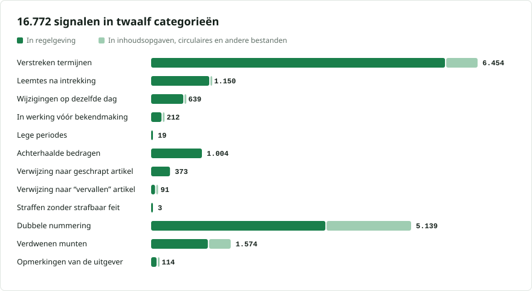

# Kwetsbaarheden in het Nederlandse recht

**Nederlands** · [English](README.en.md)

<picture>
<source media="(prefers-color-scheme: dark)" srcset="img/flags-by-category-dark.nl.svg">

</picture>

De kwetsbaarheidsdetectoren van [lexifina/global-law](https://github.com/lexifina/global-law/tree/main/vulnerabilities) zoeken naar mechanische fouten in regelgeving: een regel die nog geldt "tot" een datum die al voorbij is, een termijn die pas werd verlengd nadat hij was verstreken, een bepaling die werd ingetrokken voordat haar opvolger in werking trad, een bedrag dat op één plaats werd gewijzigd maar elders blijft staan, een verwijzing naar een artikel dat niet meer bestaat. De lijst die global-law op 9 november 2026 publiceerde, gaf voor Nederland 16 signalen, gelezen uit een eerdere commit van deze repository (`fdb8e5f`): 5 leemtes na intrekking, 5 dubbele nummers, 3 inwerkingtredingen vóór bekendmaking, 2 verwijzingen naar geschrapte bepalingen en 1 verwijzing naar een vervallen artikel, alle in het Wetboek van Strafrecht, Boek 1 van het Burgerlijk Wetboek, de Grondwet en de Uitvoeringswet AVG. Dit is een controle van alleen deze repository, met de Grondwet, het Statuut voor het Koninkrijk, 42.434 nationale regelingen en verdragen uit het Basiswettenbestand en 853 lokale regelingen van Drenthe en Flevoland, zoals ze er op 15 november 2026 uitzag, op commit [`d13d9e1`](https://github.com/lexifina/netherlands-law/commit/d13d9e1e39eb0153f8dda04ca291bf6ecae8558b). Ze geeft 16.772 signalen: veel meer van dezelfde vijf soorten (1.150 leemtes na intrekking, 5.139 dubbele nummers, 212 inwerkingtredingen vóór bekendmaking, 373 verwijzingen naar geschrapte bepalingen, 91 verwijzingen naar vervallen artikelen) en zeven categorieën die die lijst voor Nederland niet had: verstreken termijnen (6.454), wijzigingen op dezelfde dag (639), lege periodes (19), achterhaalde bedragen (1.004), straffen zonder strafbaar feit (3), verdwenen munten (1.574) en opmerkingen van de uitgever (114). Een van de drie inwerkingtredingen vóór bekendmaking die na de beoordeling van global-law overeind bleven, de geldboetecategorieën van art. 23 van het Wetboek van Strafrecht per 1 januari 2022, wordt hieronder bevestigd.

**Kort samengevat:** de detectoren gaven 16.772 signalen. Een taalmodel beoordeelde de 265 sterkste en woog bij elk de argumenten voor en tegen af; 46 bleven overeind. Na een controle met de hand in deze repository zijn twee daarvan waarschijnlijk een leemte of een redactionele fout. De bevoegdheid van art. 124, tweede lid, van de Spoorwegwet om spoorwegen als hoofdspoorweg aan te wijzen gold tot 1 januari 2005, daarna tot 2008, 2010 en 2013, en elke verlenging trad pas in werking toen de oude datum al was verstreken, zonder terugwerkende kracht, na 74, 486 en 936 dagen. En art. 15n van de Wet aanvullende bepalingen verwerking persoonsgegevens in de zorg, ingevoegd in 2025, verwijst naar "artikel 16, tweede lid", terwijl die wet sinds 2017 geen art. 16 meer heeft. Onder de signalen die het model niet beoordeelde, is art. 23 van het Wetboek van Strafrecht een derde geval: een algemene maatregel van bestuur verhoogde de maximale geldboetes met ingang van 1 januari 2022 en werd op 5 januari 2022 uitgegeven, terwijl hij volgens art. 89, derde lid, van de Grondwet niet in werking treedt voordat hij is bekendgemaakt. Van de overige 44 komen er 6 voort uit de opbouw van deze repository (de bestanden van een lokale regeling zijn naar hun plaats genummerd, zodat één bestand in de loop van de tijd verschillende artikelen bevat), zijn er 6 rechtmatig, 4 oudere regelingen ingetrokken door een opvolger die maanden na de daarin genoemde datum werd bekendgemaakt, 2 niet te beoordelen zonder het provinciaal blad, 2 uitgewerkt, 5 verkeerd gelezen door een detector en 19 hetzelfde bedrag in een andere regeling. Later wordt dit geformaliseerd in Lean, zoals ons werk aan [de belastingwetgeving van de VS](https://lexifina.com/blog/formalizing-the-us-tax-code) en [de rechtspraak van de VS](https://lexifina.com/blog/formalizing-all-us-case-law-in-lean).

Een signaal is een aanleiding om nader te kijken, geen juridisch advies, en niets hiervan is door een rechter getoetst.

## Signalen per categorie

| Categorie | Waarnaar het zoekt | Signalen | In regelgeving | Beoordeeld | Overeind na beoordeling |
| --- | --- | ---: | ---: | ---: | ---: |
| Verstreken termijnen | Tekst die een regel nog toepast "tot" een datum die al voorbij is | 6.454 | 5.810 | 46 | 2 |
| Leemtes na intrekking | Een bepaling die verviel voordat haar opvolger in werking trad | 1.150 | 1.148 | 40 | 1 |
| Wijzigingen op dezelfde dag | Twee besluiten die dezelfde bepaling wijzigen met dezelfde dag van inwerkingtreding | 639 | 636 | 40 | 2 |
| Inwerkingtreding vóór bekendmaking | Een wijziging die in werking treedt voordat het besluit dat haar aanbracht, werd bekendgemaakt | 212 | 206 | 40 | 9 |
| Lege periodes | Een termijn verlengd door een besluit dat pas in werking trad nadat hij was verstreken | 19 | 19 | 19 | 10 |
| Achterhaalde bedragen | Een bedrag dat op één plaats werd gewijzigd maar elders blijft staan | 1.004 | 1.004 | 40 | 19 |
| Verwijzingen naar geschrapte bepalingen | Een bepaling die verwijst naar een artikel dat niet meer bestaat | 373 | 373 | 40 | 3 |
| Verwijzingen naar “vervallen” artikelen | Een bepaling die verwijst naar een artikel dat alleen nog "[Vervallen]" luidt | 91 | 78 | 0 | 0 |
| Straffen zonder strafbaar feit | Een strafbepaling die verwijst naar een artikel dat "[Vervallen]" luidt | 3 | 3 | 0 | 0 |
| Dubbele nummering | Twee onderdelen met hetzelfde nummer in één bepaling | 5.139 | 3.444 | 0 | 0 |
| Verdwenen munten | Bedragen in munten die niet meer in gebruik zijn (de gulden en andere) | 1.574 | 1.121 | 0 | 0 |
| Opmerkingen van de uitgever | Opmerkingen dat een wijziging niet kon worden aangebracht, of een "(sic)" | 114 | 107 | 0 | 0 |

"In regelgeving" omvat de Grondwet, het Statuut, de wetten, de algemene maatregelen van bestuur en koninklijke besluiten, de ministeriële regelingen, de regelingen van zelfstandige bestuursorganen en voormalige productschappen, de beleidsregels, de reglementen, de archiefselectielijsten, de verdragen en de lokale regelingen. Beleidsregels (`beleidsregel/`) tellen als regelgeving: het zijn bij besluit vastgestelde algemene regels (art. 1:3, vierde lid, Awb), en het bestuursorgaan handelt overeenkomstig de beleidsregel (art. 4:84 Awb). Circulaires (`circulaire/`, `circulaire-bes/`) zijn aanwijzingen binnen de overheid en geen regelgeving, evenmin als de inhoudsopgaven die deze repository bij elke regeling als `inhoud.md` voegt, de README-bestanden, `data/` en `tools/`: daar staan 2.823 signalen, 1.653 in inhoudsopgaven, 1.167 in circulaires en 3 in README-bestanden. De detectoren voor de geschiedenis lezen de versies die deze repository bevat, 72.144 van de 148.873 nationale versies van het BWB en 1.343 lokale; voor een nationale regeling is de datum van elke commit de datum van inwerkingtreding volgens het BWB, en de commits noemen de publicatie in het Staatsblad of de Staatscourant met de datum van uitgifte en van vaststelling, zodat naar inwerkingtreding vóór bekendmaking kan worden gezocht. Voor lokale regelingen geeft het CVDR de datum van vaststelling, niet die van bekendmaking.

*Randgevallen: de 46 signalen die na de beoordeling overeind bleven, gegroepeerd naar wat ze bleken te zijn, de waarschijnlijke fout onder de signalen die het model niet beoordeelde, en wat de overige signalen zijn, in [EDGE-CASES.md](EDGE-CASES.md).*

## Problemen in deze repository

- **Lokale regelingen: één bestand, meerdere artikelen.** De bestanden van een lokale regeling zijn naar hun plaats genummerd (`art-000-43.md`), niet naar het artikel, zodat hetzelfde bestand een ander artikel bevat wanneer het CVDR een regeling vernummert of een versie bepalingen toevoegt: 1.710 bestanden van 38 lokale regelingen bevatten in de loop van hun geschiedenis meer dan één artikelnummer. In het Reglement van orde voor de vergaderingen van de statencommissies van Drenthe bevatte [`art-000-43.md`](https://github.com/lexifina/netherlands-law/blob/25e7055e5009fa2d137431ac8b949b90c7ec0725/local/provincie-drenthe/2003/cvdr92626/art-000-43.md) eerst artikel 3, daarna artikel 4 en, na twee jaar zonder bestand, artikel 33, "Toehoorders en pers"; in de Subsidieverordening natuur- en landschapsbeheer 2015 bevatte [`art-000-156.md`](https://github.com/lexifina/netherlands-law/blob/1b34b1c5113e64a51e86ad3424ef2653be17417e/local/provincie-drenthe/2010/cvdr95367/art-000-156.md) achtereenvolgens de artikelen 12.7, 12.6 en 12.5. `git log` en `git blame` van zo'n bestand vermengen verschillende artikelen, en de detectoren voor de geschiedenis lezen ze als één bepaling. Veel van de 407 leemtes na intrekking en de 639 wijzigingen op dezelfde dag in lokale regelingen, en drie van de lege periodes, komen hieruit voort; bovendien geeft het CVDR soms meerdere versies van één regeling dezelfde begindatum (drie voor de Provinciale omgevingsverordening Drenthe op 14 april 2011).

## Bestanden

| Bestand | Inhoud |
| --- | --- |
| [data/flags.csv](data/flags.csv) | Elk signaal, één rij per bepaling en probleem |
| [data/reviewed.csv](data/reviewed.csv) | De 265 signalen die het model beoordeelde, met zijn oordeel en motivering |
| [data/by_category.csv](data/by_category.csv) | De aantallen uit de tabel hierboven |
| [tools/](tools/) | De scripts waarmee deze controle werd uitgevoerd |

Kolommen: `category` en `category_nl` (de categorie in het Engels en het Nederlands), `detector`, `kind` (`law` of `other`), `path` (de bepaling in deze repository), `date` (de datum waarop het signaal betrekking heeft), `reference` (de betrokken regeling of regel), `summary`, `score` (de rangschikking door de detector, 0 tot 1), `review` (`artefact`, `lawful` of `candidate_defect`), `survives_rebuttal`, `review_note` (de motivering van het model, in het Engels), `url` (de bepaling in de gecontroleerde commit of, voor een bepaling die sindsdien is verdwenen, in de laatste commit die haar bevatte; bij een inwerkingtreding vóór bekendmaking de commit van de wijziging).

## Hoe het tot stand kwam

- **Detectoren:** de [vulnerabilities/scripts](https://github.com/lexifina/global-law/tree/main/vulnerabilities/scripts) van global-law, met de correcties in [tools/patch_detectors.py](tools/patch_detectors.py) en de Nederlandse in [tools/patch_nl.py](tools/patch_nl.py), uitgevoerd op deze repository in commit `d13d9e1`. De geschiedenistabel die de detectoren lezen, werd opgebouwd uit de eigen commits van deze repository (de publicatie die elke wijziging aanbracht en de datum uit `In-force:`); alle 65.701 gedateerde commits gelden als wijzigingen van het recht, of het BWB voor de wijziging nu een wet, een besluit of alleen de uitgever noemt. Omdat deze repository haar regelingen op 13 november 2026 naar nieuwe mappen verplaatste, werd elke wijziging van vóór die datum aan de nieuwe map van de regeling toegerekend (`data/paths.json`). De Nederlandse correcties voor deze controle: een datum met streepjes wordt gelezen met de dag voorop ("t/m 31-12-2025"), en "werkt terug tot" en "terugwerkende kracht tot" zijn geen termijnen (verstreken termijnen van 9.465 naar 6.454); een andere regeling die na het artikel wordt genoemd ("artikel 15, eerste lid, van de Wet minimumloon"), is niet de verwijzende regeling, en "artikel 3.3" of "artikel 7:670" is niet artikel 3 of 7 (verwijzingen naar geschrapte bepalingen van 1.106 naar 373); een artikel dat de woorden "vervalt" of "ingetrokken" alleen gebruikt, is geen vervallen artikel (verwijzingen naar “vervallen” artikelen van 631 naar 91); de gulden in zijn Nederlandse schrijfwijzen ("f 490,–", "ƒ", "fl.", "Hfl", "NLG", "gulden") is een verdwenen munt, maar niet de Antilliaanse gulden in de regelingen voor Curaçao en Sint Maarten, en evenmin "Afl." en "NAf." (verdwenen munten van 71 naar 1.574); en "kroon" is een kroon, niet de Estse munt.
- **Beoordeling door het model:** gpt-5.4-mini, de 40 sterkste signalen per categorie, en de 40 sterkste verstreken termijnen in regelgeving (waarvan 6 niet al bij de eerste 40). Een eerste ronde zegt of een signaal echt is, een tweede voert aan dat het dat niet is. Voor de lege periodes dient de eigen beoordeling van global-law voor die categorie, van alle 19 signalen, gevolgd door dezelfde tweede ronde. Na de tweede correctie van de verwijzingsscan werden de verwijzingen naar geschrapte bepalingen opnieuw beoordeeld. De overige vijf categorieën beoordeelt het model niet. De eigen lijst van global-law gebruikte een ander model.
- **Controle met de hand:** elk signaal dat overeind bleef, werd gelezen in de geschiedenis en de teksten van deze repository; bij elke lege periode werd nagegaan of de wijziging de oude datum in dezelfde zin door de nieuwe verving. Voor de Spoorwegwet, de Wabvpz, het Wetboek van Strafrecht en de zeven nationale inwerkingtredingen vóór bekendmaking werd het wijzigende besluit gelezen in het Staatsblad of de Staatscourant; voor de twee besluiten van Drenthe het record van het CVDR. Alle 3 straffen zonder strafbaar feit werden gelezen, net als steekproeven uit de overige categorieën. Voor de twee besluiten van Drenthe onder "niet te beoordelen" is het provinciaal blad nog nodig.

Meld een correctie in een issue, met de bepaling en een officiële bron.

## Licentie

De lijsten en toelichtingen zijn van Lexifina en vallen in het publieke domein onder CC0 1.0, net als de eigen bijdragen van deze repository. Geciteerde teksten komen uit het Basiswettenbestand en het CVDR (KOOP), die KOOP als open data onder CC0 1.0 publiceert; Nederlandse wetten, besluiten en verordeningen zijn bovendien niet auteursrechtelijk beschermd (art. 11 Auteurswet). Zie [LICENSE](../LICENSE).
